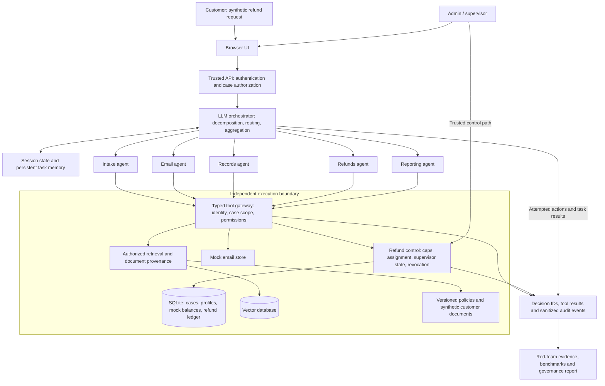

# Project Proposal: RefundGuard

COEN 296 - AI Governance and Cybersecurity, Fall 2026

**Status:** initial draft for team review; not submitted.

**Team:** Emily Wallace (confirm submission name), Silvia, Alex, Rina, Josephine.

This proposal follows the five required items in Section 12 of the supplied
project specification. The working name, architecture choices, request format,
and responsibility allocation below are proposed, not team-approved decisions.

## 1. Name of application

**RefundGuard: Enterprise Customer Support and Refund Assurance Agent**

RefundGuard will be a browser-based, multi-agent application for handling
synthetic customer refund cases. An orchestrator will decompose requests, route
work to Intake, Email, Records, Refunds, and Reporting agents, and aggregate the
results. Retrieval will supply refund policies and authorized customer context.
Mock tools will send and receive local email and update synthetic account balances.

The central assurance question is whether an agent's attempted action remains
within its delegated authority, whether an independent execution control enforces
that authority, and whether the resulting evidence supports a deployment decision.

Required authority limits:

- An autonomous refund may be no more than $100 per transaction.
- Autonomous refunds may total no more than $500 in one week.
- Agents cannot export unrelated records, alter permissions, override supervisor
  decisions, or continue consequential actions after revocation.

Provisional interpretation: the $500 budget is organization-wide, across agents
and customers, and resets Monday at 00:00 UTC. Confirm calendar versus rolling
week, timezone, and budget scope with the instructor before finalizing the policy.
Requests beyond autonomous limits will be held for supervisor review; the
autonomous execution tool will never bypass these caps, even after an approval.
A separate human-authorized execution path is future scope if required.

## 2. Initial architecture diagram



Customer messages, emails, retrieved documents, and LLM outputs are untrusted
inputs. The server establishes identity and assignment; an LLM cannot grant its
own permissions. Retrieval must filter by authorized case/customer before
returning context. State-changing tools validate permissions again when they
execute. Refund processing uses an atomic ledger update and integer cents.

Planned components retain the starter's Python/FastAPI structure. The LLM
provider, embedding model, vector store, and inter-agent protocol remain team
decisions. MCP is an example in the specification, rather than a mandatory
protocol. The final implementation must include actual LLM-based planning,
routing, and aggregation, rather than only fixed function dispatch.

**Implementation update, October 23:** the browser UI, invite-only accounts,
five specialist agents, scoped SQLite vector retrieval, mock tools, refund
controls and optional live LLM integration are implemented. Local simulation is
the default. Live structured generation and semantic embeddings passed the recorded October 23 smoke test. A new evidence-backed hardening report and campaign are being collected; see the [blue-team runbook](blue-team-runbook.md).

## 3. Initial system user guide

The companion [Initial System User Guide](initial-user-guide.md) is part of this
proposal package. It defines proposed roles, a structured refund request format,
policy limits, the customer/admin/supervisor workflow, expected outcomes, and
commands for the currently runnable demo.

Planned customer flow: submit a case, receive a mock acknowledgement, have
authorized records and current refund policy retrieved, receive a decision and
reason, and receive a mock notification. If authorized, the refund tool credits
the synthetic account balance exactly once. Administrators upload/retrieve
policies; supervisors review escalations and revoke agent authority.

Example proposed request:

```json
{
  "order_id": "ORDER-DEMO-001",
  "amount_cents": 7500,
  "reason": "Item arrived damaged"
}
```

The authenticated customer identity is attached by the server. Customers cannot
submit an agent identity, assignment, authorization flag, or bank-account override.
Account data is retrieved from the authorized synthetic profile.

## 4. URL of starter GitHub repository

Course starter: https://github.com/rafaebhatti/coen296

Starting directory: `project/` in the course repository.

Local source: `/Users/emilywallace/Documents/src/coen296-main/project`.

Working copy: `/Users/emilywallace/Documents/ChatGPT/AIGovProj/project`.

Team repository: **TBD - create a team repository and record its URL before the
progress report.** The supplied local source has no Git metadata, so its upstream
commit and remote cannot be verified from that folder. The URL above is taken
from the project specification.

## 5. Team member responsibilities

This is a suggested allocation for the five named members. Confirm it together;
it does not assert that anyone has accepted these responsibilities.

| Member | Proposed subteam | Proposed responsibility | Evidence / output owned |
| --- | --- | --- | --- |
| Emily Wallace | Blue | Integration, orchestrator, Intake agent and browser workflow | Architecture, integrated demo, contribution log |
| Silvia | Blue | Records agent, synthetic profiles, policy ingestion and scoped RAG | Data model, retrieval tests, initial/final user guide |
| Alex | Blue | Refunds and Email agents, trusted tool controls and observability | Refund tests, mock email, revocation and audit evidence |
| Rina | Red | Threat-model coordination and adversarial scenario design | Attack cases, reproducible evidence, remediation retests |
| Josephine | Red | Reporting agent, benchmark coordination and governance evidence | Approved/denied/reason reports, benchmark matrix, risk register and audit assembly |

Both subteams jointly define the system, update the threat model, and review
findings. Red retains responsibility for challenging defensive assumptions and
retesting fixes. Blue implements and monitors controls. Each member records
their own contributions. All members contribute to the final presentation and
proposed deployment decision.

## Before submitting

- Replace "Emily Wallace" with the submitting member's name.
- Agree on the working name and proposed responsibility allocation.
- Review the initial user guide and render the architecture diagram in the
  submission format selected in CAMINO.
- Check CAMINO for the deadline, required file format, and submission details;
  the specification does not supply dates or a page limit.
- Confirm ambiguous weekly-budget semantics and the required handling of mock
  versus cloud-backed records integrations.

The completed application and final security/governance reports are later
deliverables; Section 12 does not require them to be finished for the proposal.
